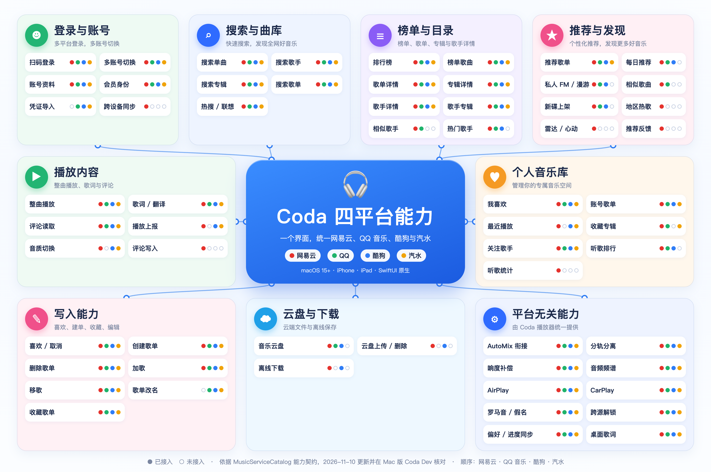

# 音乐平台能力与账号管理

[返回架构说明](README.md)

Coda 在同一套界面中接入网易云音乐、QQ 音乐、酷狗音乐和汽水音乐。各平台共用现有页面与组件，仅切换数据和可用功能；功能是否出现由 `MusicServiceCatalog` 的能力契约决定。

能力总览图：<a href="../assets/platform-capabilities.html">platform-capabilities.html</a> 为源文件，重新生成方式见文件头注释。

## 能力总览

下表按 `MusicServiceCatalog` 的 51 项能力汇总（✅ 已接入，— 未接入）；接入数量：网易云 51 / QQ 37 / 酷狗 39 / 汽水 31。每项对应的具体接口与语义边界见 [music-api-mapping.md](music-api-mapping.md)。

| 功能 | 网易云 | QQ 音乐 | 酷狗 | 汽水 |
| --- | :---: | :---: | :---: | :---: |
| **登录与账号** | | | | |
| 扫码登录 | ✅ | ✅ | ✅ | ✅ |
| 账号资料 | ✅ | ✅ | ✅ | ✅ |
| 跨设备账号同步 | ✅ | — | — | — |
| **搜索** | | | | |
| 搜索单曲 | ✅ | ✅ | ✅ | ✅ |
| 搜索歌手 | ✅ | ✅ | ✅ | ✅ |
| 搜索专辑 | ✅ | ✅ | ✅ | ✅ |
| 搜索歌单 | ✅ | ✅ | ✅ | ✅ |
| 热搜 / 联想 | ✅ | ✅ | ✅ | ✅ |
| **榜单与目录** | | | | |
| 排行榜 | ✅ | ✅ | ✅ | ✅ |
| 榜单歌曲 | ✅ | ✅ | ✅ | ✅ |
| 歌单详情 | ✅ | ✅ | ✅ | ✅ |
| 歌曲详情 | ✅ | ✅ | ✅ | ✅ |
| 专辑详情 | ✅ | ✅ | ✅ | ✅ |
| 歌手详情 | ✅ | ✅ | ✅ | ✅ |
| 歌手专辑 | ✅ | ✅ | ✅ | ✅ |
| 相似歌手 | ✅ | ✅ | — | — |
| 热门歌手 | ✅ | ✅ | ✅ | — |
| **推荐与发现** | | | | |
| 推荐歌单 | ✅ | ✅ | ✅ | ✅ |
| 推荐歌曲 | ✅ | ✅ | ✅ | — |
| 每日推荐 | ✅ | ✅ | ✅ | — |
| 私人 FM / 漫游 | ✅ | ✅ | ✅ | — |
| 相似歌曲推荐 | ✅ | ✅ | — | — |
| 新碟上架 | ✅ | ✅ | ✅ | — |
| 地区热歌 | ✅ | — | — | — |
| 雷达歌单 | ✅ | — | — | — |
| 心动模式 | ✅ | — | — | — |
| 精品歌单 | ✅ | — | — | — |
| 推荐反馈 | ✅ | — | — | — |
| FM 反馈 | ✅ | — | — | — |
| **播放内容** | | | | |
| 整曲播放 | ✅ | ✅ | ✅ | ✅ |
| 音质切换 | ✅ | — | ✅ | ✅ |
| 歌词 | ✅ | ✅ | ✅ | ✅ |
| 评论读取 | ✅ | ✅ | ✅ | ✅ |
| 评论写入 | ✅ | — | — | — |
| 播放上报 | ✅ | — | ✅ | ✅ |
| **个人音乐库** | | | | |
| 账号歌单 | ✅ | ✅ | ✅ | ✅ |
| 喜欢的歌曲 | ✅ | ✅ | ✅ | ✅ |
| 最近播放 | ✅ | — | ✅ | ✅ |
| 收藏专辑 | ✅ | ✅ | — | ✅ |
| 关注歌手 | ✅ | ✅ | ✅ | ✅ |
| 个人听歌排行 | ✅ | ✅ | ✅ | — |
| 听歌统计 | ✅ | — | — | — |
| **写入能力** | | | | |
| 喜欢 / 取消喜欢 | ✅ | ✅ | ✅ | ✅ |
| 创建歌单 | ✅ | ✅ | ✅ | ✅ |
| 删除歌单 | ✅ | ✅ | ✅ | ✅ |
| 向自建歌单加歌 | ✅ | ✅ | ✅ | ✅ |
| 移歌（QQ / 酷狗 / 汽水另含改名） | ✅ | ✅ | ✅ | ✅ |
| 收藏歌单 | ✅ | ✅ | ✅ | ✅ |
| **云盘与下载** | | | | |
| 音乐云盘 | ✅ | ✅ | ✅ | — |
| 云盘上传 / 删除 | ✅ | — | ✅ | — |
| 离线下载 | ✅ | — | ✅ | — |

说明：

- **推荐不等于个性化。** QQ 的每日推荐与推荐歌曲来自榜单混排，推荐歌单来自官网热门歌单；酷狗的每日推荐同样不套用“根据你的口味”文案。汽水首页提供听歌场景（电台）和排行榜，没有每日推荐。
- **酷狗的专辑详情**用真实 album_id 分页读取（仅在缺少 ID 时按名称匹配唯一专辑）；**歌手专辑列表**按歌手名搜索匹配，不是完整唱片目录；新碟每个地区只返回少量且不能翻页。
- **云盘**：网易云支持列表、上传、删除；酷狗支持列表、容量、播放、分片上传（含秒传）和删除；QQ 为只读列表（`WeiyunMusicRead.GetMatchAudio`）；汽水没有云盘。
- **下载**：只提供完整且可校验的曲库音频（酷狗校验大小、MD5、时长）；云盘内容不提供下载。
- **音质**：网易云、酷狗、汽水接入音质切换，QQ 暂未接入；四档名称与码率显示规则见 [unified-audio-quality.md](unified-audio-quality.md)（该文以网易云、QQ、酷狗为例）。
- **平台无关的能力**由 Coda 播放器统一提供，与所选平台无关：AutoMix、分轨分离、响度补偿、音频频谱、AirPlay、CarPlay、罗马音与假名、跨源解锁、桌面歌词、偏好与播放进度同步。跨设备**账号**同步（`accountSync`）目前仅网易云。
- 平台接口不是官方承诺稳定的开放 API，账号会员与版权最终由各平台播放接口决定；不把网易云的会员判断套用到其他平台。

## 补齐记录（2026-11-10）

本轮把“上游已有接口、Coda 未接入”的功能补进能力契约和界面（QQ 除外）：

| 平台 | 新接入 | 验证情况 |
| --- | --- | --- |
| 网易云 | 搜索页默认搜索词与输入联想（原有 `searchSuggest / searchDefaultKeyword` 接口此前无人调用） | Mac 实测可见 |
| 汽水 | 热搜词与输入联想；自建歌单删除、改名、加歌、移歌 | 热搜与联想 Mac 实测可见，回包形状以真实响应写入单元测试；写操作只做请求体与成功判定的单元测试 |
| 酷狗 | 输入联想；歌单搜索（`/v1/search/special`）；关注 / 取消关注歌手与关注列表；喜欢 / 取消喜欢（编辑「我喜欢」歌单）；自建歌单移歌（按歌单内 `fileid`）与改名（`/v1/modify_list`） | 联想、歌单搜索与歌单详情、关注列表 Mac 实测可见；真实账号只读核对：歌单行都带 `fileid`、歌曲能匹配到 `fileid`，自建歌单返回简介 / 标签 / 排序（改名时原样回传，避免清空）；关注、喜欢、移歌、改名等写操作未对账号执行 |

写操作都没有用你的账号实际执行，需要逐项验收。关注列表目前不带歌手头像（返回字段未匹配），仅显示名称。

### 上游有接口但仍未接入

| 平台 | 项目 | 原因 |
| --- | --- | --- |
| QQ | 音质切换 | 代码已有逐档探测和菜单，契约未登记；非会员账号播放均走外部音源，无法实测，待会员账号验收后再登记 |
| 酷狗 | 相似歌曲 | `album_audio/related` 实测返回同一首歌的其他版本 / 翻唱，`ai_recommend` 未登录时返回“随机推荐 · 相似度低”，均不等于相似歌曲，故不接入 |
| 酷狗 | 评论发表 / 回复 / 删除 | 需要从评论列表解析 `special_id` 并改造网易云专用的评论输入区，且发表会公开可见，无法安全实测 |
| 汽水 | 离线下载 | 播放已有加密 MP4 本地解密，但离线下载契约要求可校验的完整文件，需单独设计 |
| 汽水 | 听歌时长（`music_wall`）、播放计数上报（`/luna/pc/action`）、删除最近播放、歌单排序 / 敏感词检查 | 时长单位未确认；计数上报属于埋点；后两项没有对应界面 |

## 账号管理

设置 → 账号管理可在四个平台之间切换。扫码登录后可保存多个账号，再用「切换」选择；切换会停止当前播放、清空当前队列及导航，并刷新对应账号的音乐库。移除账号只移除本机登录凭证，不会删除平台歌单或卸载应用。

- QQ：QQ 扫码，或导入已登录 QQ 音乐网页 Cookie（含微信网页登录态）。
- 酷狗：酷狗音乐扫码，或导入用户 ID / Token。
- 汽水：使用已登录的汽水音乐 App 扫码（旧二维码页面 404，已切换 PC 扫码路由）；登录通过独立 WebKit 会话取得签名，细节见 [qishui-integration.md](../development/qishui-integration.md)。
- 凭证保存在本应用钥匙串，不参与跨设备登录同步；网易云原有登录、云盘和同步逻辑保留。

### 对象标识与隔离

歌曲、歌单等对象使用「平台 + 对象类型 + 平台原始句柄」生成稳定负数 ID，与网易云正数 ID 分开。歌曲携带平台原始元数据，可从播放检查点或缓存恢复；账号切换后的旧请求不能更新新会话。`Core/API/Providers` 是 QQ / 酷狗的网络与登录适配，`PlatformMusicAPI` 负责转换模型，`MusicProviderContext` 负责请求代际，`MusicAccountManager` 管理钥匙串中的账号。

## 账号会员状态
账号管理页在昵称后显示各账号查询到的会员身份。查询使用保存账号自己的凭证和独立会话，不切换当前播放账号。进入页面时刷新；查询失败或字段缺失不等同于非会员，已有结果显示“待更新”。旧账号数据没有会员快照时仍可读取。

| 平台 | 只读接口 | 身份判断 |
| --- | --- | --- |
| 网易云音乐 | `/weapi/music-vip-membership/client/vip/info` | 按有效期检查 `redplus`（黑胶SVIP）、`associator`（黑胶VIP）、`musicPackage`（音乐包）。成长等级不代表有效会员身份。 |
| QQ 音乐 | `VipLogin.VipLoginInter.vip_login_base` | 使用 `data.identity`；`HugeVip` 对应超级会员，`LMFlag` / `svip` 对应豪华绿钻，`vip` 对应绿钻；读取对应有效期。`svip` 和等级数字不能直接判为超级会员。 |
| 酷狗音乐 | `https://kugouvip.kugou.com/v1/get_union_vip` | 使用 `data.vip_type`、有效期及明确的会员名称；该接口的类型 6 对应超级VIP，11 对应豪华VIP。其他正数类型只显示 VIP会员，不猜测具体产品。 |

参考接口实现：

- [网易云会员接口](https://github.com/neteasecloudmusicapienhanced/api-enhanced/blob/main/module/vip_info_v2.js)
- [QQ 音乐会员身份字段](https://github.com/MeoProject/lx-music-api-server/blob/main/modules/refresh/tx.py)
- [QQ 音乐另一种 identity 返回结构](https://github.com/chongya369/qqmusic-api-py/blob/main/qqmusic/apis/user.py)
- [酷狗联合会员接口](https://github.com/MakcRe/KuGouMusicApi/blob/main/module/youth_union_vip.js)
- [酷狗会员产品及名称](https://m.kugou.com/vip/v3/vip.html?source_id=207416)
- [网易云官方 App 订阅名称](https://apps.apple.com/cn/app/id590338362)
- [QQ 音乐官方 App 订阅名称](https://apps.apple.com/cn/app/id414603431)

酷狗云端能力的协议、数据边界和验证方式见 [kugou-cloud-library.md](../development/kugou-cloud-library.md)。

## Mac 实测记录

日期：2026-11-10。在 Mac 版 Coda Dev 中，用已登录的四个账号逐个切换，只做读取，未对任何账号执行写入、创建、删除或收藏。

| 检查项 | 网易云 | QQ 音乐 | 酷狗 | 汽水 |
| --- | --- | --- | --- | --- |
| 账号管理显示会员身份 | 黑胶 SVIP | 非会员 | 超级 VIP | 汽水会员 |
| 首页板块 | 喜爱歌曲推荐、为你推荐、榜单、推荐歌单、近期热播等 | 每日 30 首、猜你喜欢、私人漫游、喜爱歌曲推荐、推荐歌单、近期热播、新歌速递、电台 | 每日推荐、私人漫游、排行榜、推荐歌单、近期热播、专属好歌、新歌速递 | 听歌场景（电台）、排行榜 |
| 精选页 | 未逐项查看 | 歌单分类标签（全部、排行榜、官方歌单、情歌等） | 推荐、最新、最热、热藏、飙升、排行榜 | 全部 / 推荐歌单标签 |
| 搜索标签（搜索「周杰伦」） | 综合 / 单曲 / 歌手 / 专辑 / 歌单 | 综合 / 单曲 / 歌手 / 专辑 / 歌单，另有热搜词 | 综合 / 单曲 / 歌手 / 专辑（无歌单） | 综合 / 单曲 / 歌手 / 专辑 / 歌单 |
| 侧栏「我的」 | 我喜欢的音乐、已下载、最近播放、我的收藏、音乐云盘 | 我喜欢的音乐、我的收藏、音乐云盘（无最近播放、无已下载） | 我喜欢的音乐、已下载、最近播放、音乐云盘 | 我喜欢的音乐、最近播放、我的收藏（无云盘、无已下载） |
| 歌单区 | 创建的歌单 / 收藏的歌单 | 我的歌单 / 收藏的歌单 | 我的歌单 | 我的歌单 / 收藏的歌单 |

核对结果：

- 以上界面入口与能力契约一致；搜索标签、最近播放、下载、云盘的显示都随平台契约变化。
- 实测发现旧文档已过时，本次已更正：旧版称 QQ 云盘、歌单删除与加歌、收藏专辑、关注歌手、搜索歌单等“暂不支持”，契约及界面中均已接入；旧版称汽水的音质切换、喜欢写入、歌单创建和收藏“暂不开放”，契约中已接入；旧版把平台数写作“三个”。
- 第二轮（补齐后）：网易云、酷狗、汽水搜索页均出现热搜 / 联想词；酷狗搜索出现「歌单」标签且歌单可打开，侧栏「我的收藏」列出已关注歌手。
- 未覆盖：真实播放与音质切换、各类写操作（喜欢、建单、收藏、关注、云盘上传）、下载、评论、汽水播放上报的云端回读、QQ 云盘有数据时的播放，以及 iPhone / iPad 端的同类检查。这些仍以本地模拟响应或此前记录为准，需要对应账号逐项验收。
